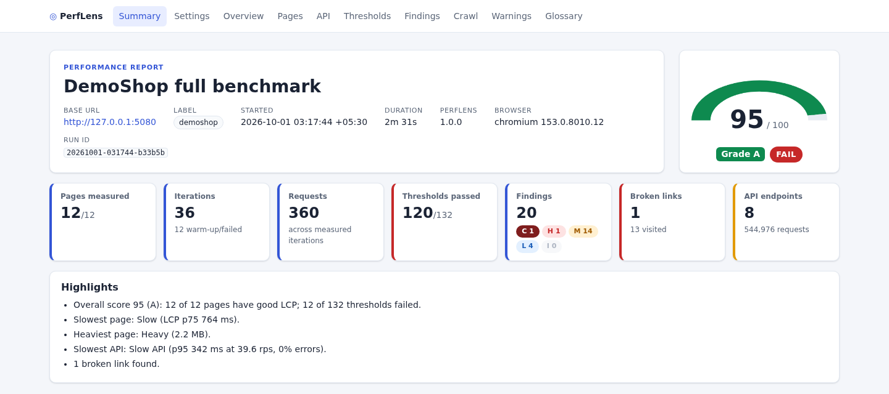
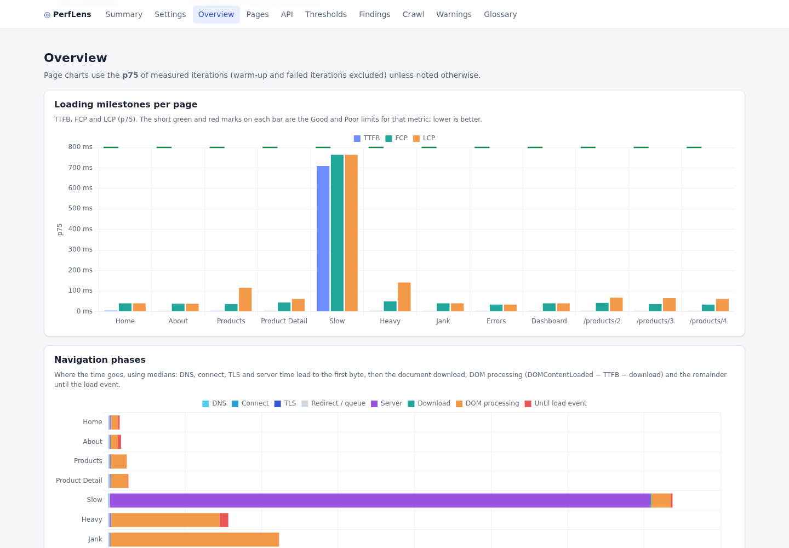
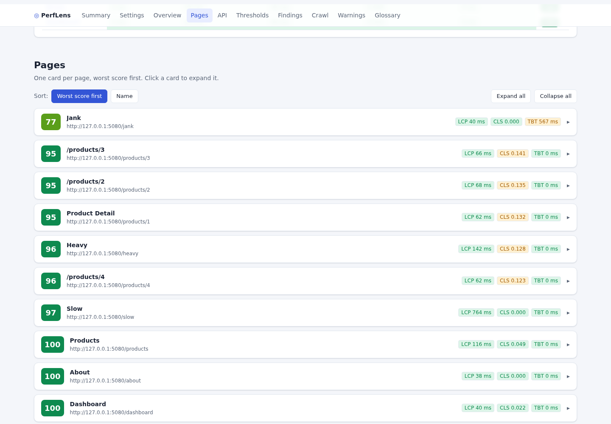
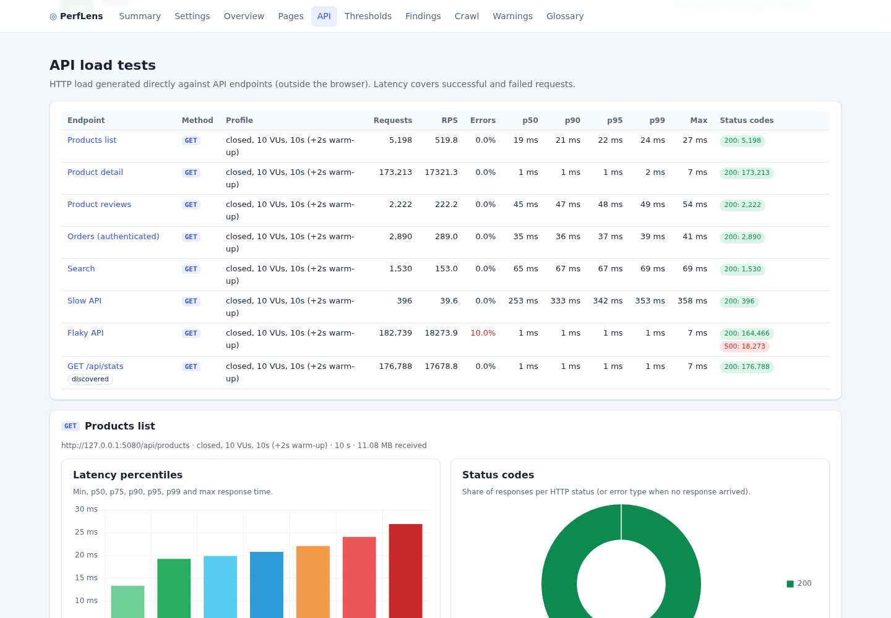

# PerfLens

**Evidence-based performance benchmarking for whole web applications: real-browser page metrics, API load testing, analysis and a shareable report, in one CLI.**

PerfLens opens every page of your app (the ones you list plus the ones it finds by crawling, including logged-in areas) in a real browser, several times. It collects Core Web Vitals, navigation timing, resource weight, API calls and errors, load-tests your APIs, and analyses everything into scores, findings and pass/fail thresholds. The result is a self-contained HTML report with charts, plus JSON, Markdown and CSV files for CI.

> **Black-box:** PerfLens needs only your application's **URL** (plus login steps, headers or cookies for protected areas, and optionally API paths). It does **not** need your source code or repository access.



<details>
<summary>More of the report (DemoShop sample run)</summary>





</details>

## What it measures

| Area | Metrics |
|---|---|
| Core Web Vitals & paint | FCP, LCP (+ element), CLS, TBT, long tasks |
| Navigation timing | DNS, connect, TLS, server time, TTFB, download, DOM interactive, DOMContentLoaded, load |
| Page weight | Requests and bytes by type (transferred and decoded), failed, third-party and cached requests, largest resources with compression and cache headers |
| In-page APIs | XHR/fetch calls: method, route (`/api/products/{id}`), status, duration, size |
| Health | Console errors, uncaught exceptions, broken links, DOM size, JS heap |
| API load | p50/p75/p90/p95/p99/max latency, throughput, error rate, status codes, error types, histogram, per-second timeline |

## Features

- **Many pages, no test code:** configured pages plus a safe same-origin crawl (GET-only, logout/delete links excluded).
- **Authenticated areas:** scripted UI login, header tokens, cookies or a Playwright storage state file; the session is reused for API tests.
- **Statistics, not snapshots:** warm-up + N iterations per page, cold or warm cache, min/median/p75/p90/p95/p99/stddev/CoV.
- **Real browsers:** Chromium, Firefox or WebKit via Playwright; device emulation, network and CPU throttling.
- **API load testing:** closed model (N virtual users) or open model (fixed rate, free of coordinated omission); can auto-select the GET APIs your pages call.
- **Analysis:** Core Web Vitals ratings, Lighthouse-style page scores, API scores, overall grade A–F, and a catalog of rule-based findings (slow server, heavy pages, uncompressed assets, N+1 API calls, tail latency, regressions, …) with recommendations.
- **CI gating:** thresholds (global and per page/endpoint), minimum score, exit codes, baseline regression detection, `summary.md` for PRs.
- **Shareable report:** one offline HTML file with Chart.js charts, built in; no CDN.
- **Easy install:** one script on Linux/WSL/macOS; .NET 10.

## Install

```bash
git clone https://github.com/vivekk1010/PerfLens.git && cd PerfLens
./scripts/install.sh          # add --with-deps on a fresh Linux box to install browser OS libraries
perflens doctor
```

The script installs the .NET 10 SDK to `~/.dotnet` if needed, publishes the CLI to `~/.local/lib/perflens`, adds `~/.local/bin/perflens` and installs Chromium. Options: `--with-deps`, `--browsers`, `--prefix`, `--dry-run`, `--uninstall`. Windows or manual install: see [DETAILS.md § Installation](docs/DETAILS.md#1-installation).

## Quick start

**Try the demo app** (it has deliberate performance problems):

```bash
./scripts/run-demo.sh           # starts DemoShop, runs PerfLens, stops DemoShop
./scripts/run-demo.sh --quick   # shorter run
```

**Measure your own app:**

```bash
perflens quick https://your-app.example.com
perflens quick https://your-app.example.com --pages /,/pricing,/docs --api /api/products
perflens quick https://your-app.example.com --crawl --max-pages 30
```

**Use a config file for repeatable runs:**

```bash
perflens init perflens.yaml        # commented starter config
perflens validate -c perflens.yaml
perflens run -c perflens.yaml --open
```

## Minimal config

```yaml
name: My app
target:
  baseUrl: https://staging.example.com
auth:
  type: Login
  login:
    url: /login
    steps:
      - { action: Fill, selector: "#email", value: "${ENV:APP_USER}" }
      - { action: Fill, selector: "#password", value: "${ENV:APP_PASSWORD}" }
      - { action: Click, selector: "button[type=submit]" }
    successUrlPattern: /dashboard
pages:
  - { name: Home, path: / }
  - { name: Dashboard, path: /dashboard }
crawl:
  enabled: true
  maxPages: 20
browser:
  iterations: 5
  cacheMode: Cold
api:
  enabled: true
  endpoints:
    - { name: Products, url: /api/products }
  profile: { mode: Closed, concurrency: 10, durationSeconds: 20 }
thresholds:
  pageStatistic: p75
  page: { lcpMs: 2500, cls: 0.1, tbtMs: 200 }
  api: { p95Ms: 800, errorRatePct: 1 }
```

Secrets come only from environment variables (`${ENV:NAME}`, `${NAME}`, `${NAME:-default}`). All options: [configuration reference](docs/DETAILS.md#4-configuration-reference) and [`configs/template.yaml`](configs/template.yaml).

## CLI

| Command | Purpose |
|---|---|
| `perflens run -c <file> [--url] [-o] [--baseline] [--label] [--iterations] [--headed] [--no-api] [--no-crawl] [--formats] [--open] [-v]` | Full benchmark from a config file |
| `perflens quick <url> [--pages /,/about] [--crawl] [--max-pages n] [--iterations n] [--api <path>]... [-o] [--label] [--formats] [--headed] [--open] [-v]` | Zero-config run (3 iterations by default) |
| `perflens init [path] [--force]` | Write a commented starter config (default `perflens.yaml`) |
| `perflens validate -c <file>` | Validate config and print a resolved summary |
| `perflens report <results.json> [-o] [--formats] [--open]` | Re-render reports from saved results |
| `perflens install-browsers [chromium\|firefox\|webkit\|all] [--with-deps]` | Install Playwright browsers |
| `perflens doctor` | Check .NET, browser install and a headless launch |
| `perflens --version`, `--help` | Version and help |

**Exit codes:** `0` success · `1` thresholds or min score failed (with `thresholds.failOnThresholdBreach`) · `2` invalid config/arguments · `3` unexpected runtime error · `130` cancelled (Ctrl+C). If the browser cannot launch, pages are reported as unavailable and the run fails with `1`; `perflens doctor` diagnoses it.

## Outputs

Written to `perflens-results/<yyyyMMdd-HHmmss>/` by default:

| File | What |
|---|---|
| `report.html` | Self-contained interactive report: score gauge, vitals, phases, weight, per-page cards, API charts, thresholds, findings, baseline deltas, crawl |
| `results.json` | Complete data; use as `--baseline` next time |
| `summary.md` | Short summary for PR comments / CI job summaries |
| `pages.csv`, `iterations.csv`, `api.csv`, `findings.csv`, `thresholds.csv` | Raw tables for spreadsheets and further analysis |
| `screenshots/` | One screenshot per page |

## CI example (GitHub Actions)

```yaml
- uses: actions/checkout@v4
- run: ./scripts/install.sh --with-deps --browsers chromium && echo "$HOME/.local/bin" >> "$GITHUB_PATH"
- run: perflens run -c perf/perflens.yaml -o perflens-out --label "${GITHUB_SHA::7}"
  env:
    APP_PASSWORD: ${{ secrets.APP_PASSWORD }}
- if: always()
  run: cat perflens-out/summary.md >> "$GITHUB_STEP_SUMMARY"
- if: always()
  uses: actions/upload-artifact@v4
  with: { name: perflens-report, path: perflens-out/ }
```

`-o` writes to exactly that folder (no timestamped subfolder). A full workflow that downloads the last `main` run as a baseline is in [DETAILS.md § CI gating](docs/DETAILS.md#141-github-actions-example).

## Documentation

- [Product requirements (PRD)](docs/PRD.md): problem, goals, personas, user stories, requirements, roadmap.
- [Architecture](docs/ARCHITECTURE.md): modules, pipeline, data model, measurement, load and analysis internals, design decisions.
- [Technical details & user guide](docs/DETAILS.md): configuration reference, metric formulas, scoring, findings catalog, outputs, troubleshooting, FAQ.

## Project structure

```text
PerfLens/
├── src/
│   ├── PerfLens.Core/        # config model + loader, result model, stats, interfaces, URL/platform utils
│   ├── PerfLens.Browser/     # Playwright page runner: auth, crawl, measurement
│   ├── PerfLens.Load/        # HTTP load generator (closed/open), request factory, endpoint discovery
│   ├── PerfLens.Analysis/    # summaries, ratings, scores, thresholds, findings, regressions
│   ├── PerfLens.Reporting/   # HTML (inline Chart.js), JSON, Markdown, CSV writers
│   └── PerfLens.Cli/         # `perflens` command
├── samples/PerfLens.DemoShop/ # demo app with deliberate performance issues
├── tests/                    # Core, Browser, Load, Analysis, Reporting, E2E test projects
├── configs/                  # demoshop.yaml, demoshop-quick.json, template.yaml, api-only.yaml
├── scripts/                  # install.sh, run-demo.sh, start-demoshop.sh
└── docs/                     # PRD, architecture, details
```

## Build and test

```bash
dotnet build
perflens install-browsers chromium    # browser and E2E tests need Chromium
dotnet test
```

`PerfLens.Browser.Tests`, `PerfLens.Reporting.Tests` and `PerfLens.E2E.Tests` launch real Chromium (against an in-process Kestrel site or DemoShop).

## FAQ

**Do I need access to the application's source code?** No. PerfLens is black-box: every metric comes from the browser (Navigation Timing, Paint Timing, LCP, Layout Instability, Long Tasks, Resource Timing, Playwright network events) and from HTTP requests to the deployed endpoints. Repo access only helps with optional extras such as running it in the app's own CI pipeline or correlating with server-side traces.

**Can it test SPAs?** Yes: list the routes as pages and use `waitForSelector` to wait for real content.

**Is it safe on production?** Page runs are GET-only and exclude logout/signout/delete links by default. Load tests are opt-in and stress the system, so use modest profiles and get agreement first.

More in the [FAQ](docs/DETAILS.md#20-faq).

## License

[MIT](LICENSE) © 2026 Vivek Kaushik
