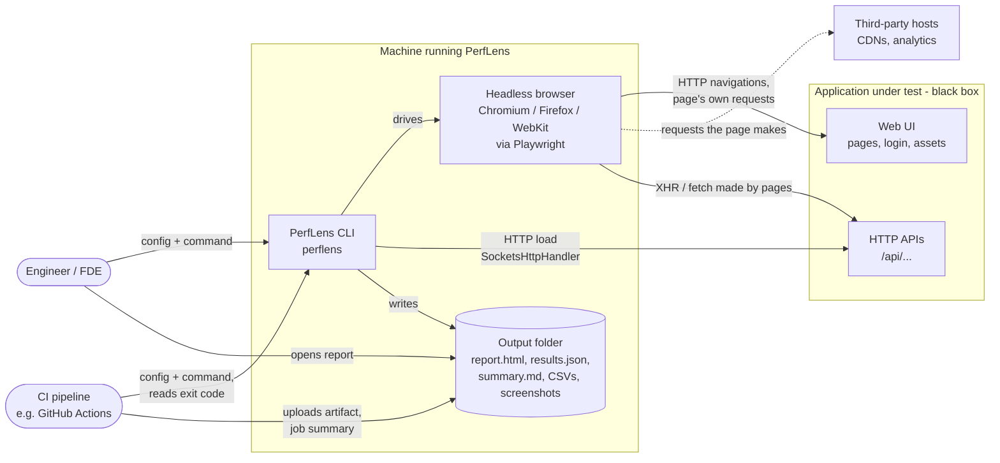
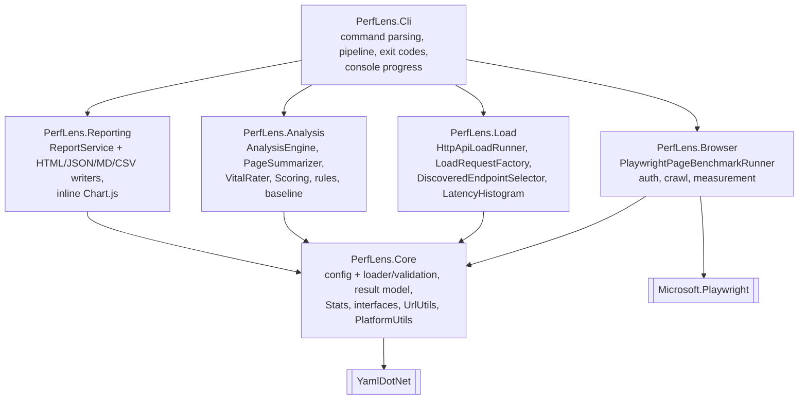
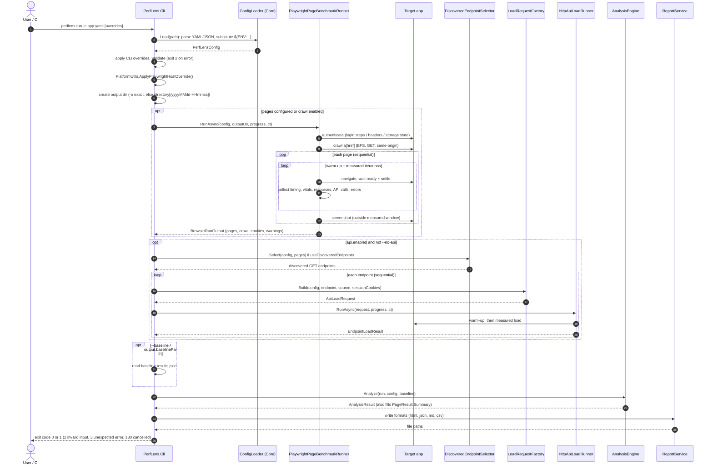
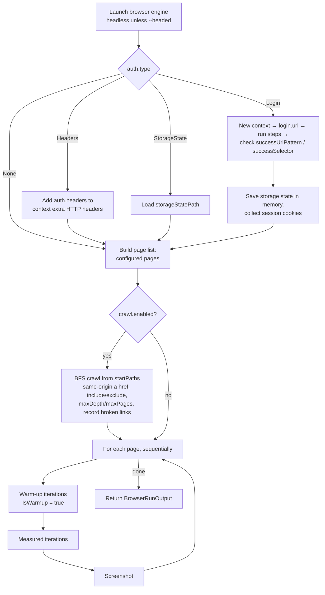
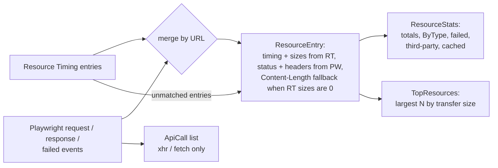
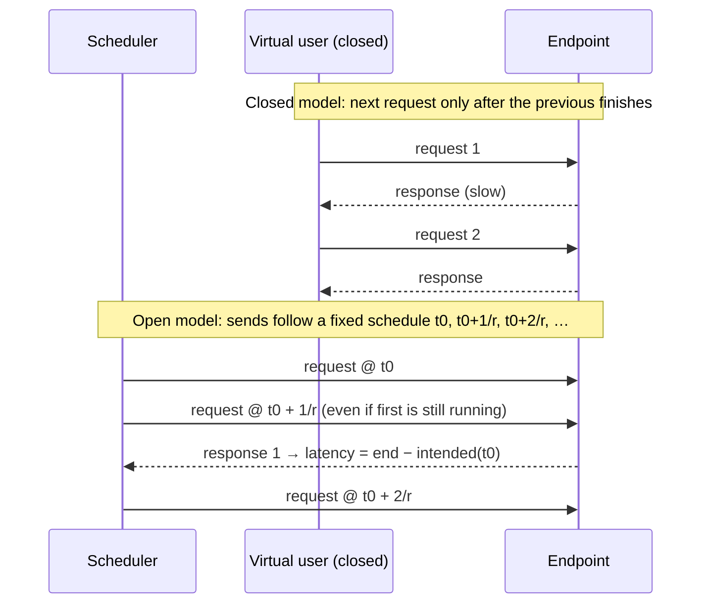
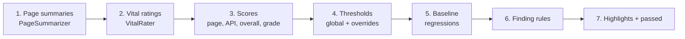
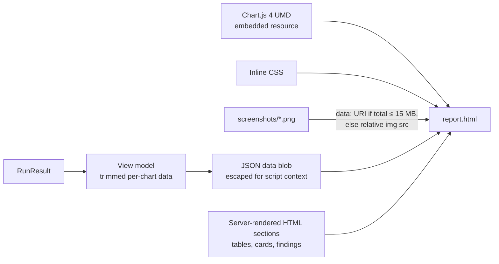
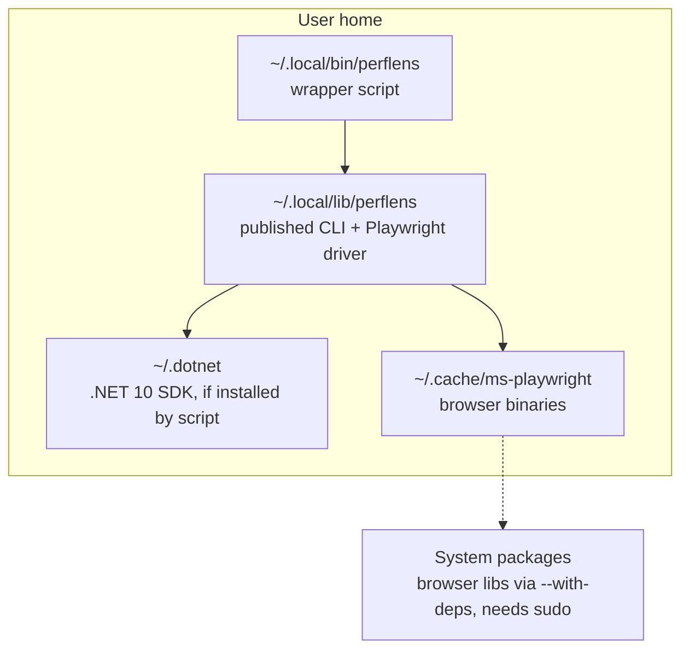

# PerfLens — Architecture

This document describes how PerfLens is built: its context, modules, run pipeline, data model, and the internals of the browser runner, load engine, analysis engine and reporting. It ends with design decisions, testing strategy and known limitations.

Related: [PRD](PRD.md) · [Technical details & user guide](DETAILS.md) · [README](../README.md)

---

## 1. System context

PerfLens is a command-line tool that runs on a user's machine or a CI runner. It treats the application under test as a black box: it talks to the app only through its public UI URL and HTTP endpoints, exactly like a user's browser or an API client would. It needs no access to the application's source code, repositories, servers or telemetry.



Notes:

- Third-party requests are only those the pages themselves make during a normal browser load. PerfLens never sends load to third-party hosts.
- The only inputs are the config file (YAML/JSON), CLI arguments and environment variables referenced in the config.

## 2. Modules (containers)

Each module is a .NET 10 project. Dependencies point inward to `PerfLens.Core`, which holds contracts and shared models and has no dependency on Playwright or HTTP load code.



| Module | Responsibility | Key types |
|---|---|---|
| `PerfLens.Core` | Config schema, loading, env substitution and validation; result model; statistics; module interfaces; URL and platform utilities | `PerfLensConfig`, `ConfigLoader`, `RunResult`, `AnalysisResult`, `MetricNames`, `Stats`, `UrlUtils`, `PlatformUtils`, `JsonDefaults`, `IPageBenchmarkRunner`, `IApiLoadRunner`, `IAnalysisEngine`, `IReportWriter`, `IProgressReporter` |
| `PerfLens.Browser` | Launch browser, authenticate, build page list (configured + crawl), measure each page | `PlaywrightPageBenchmarkRunner`, resource classifier, init script |
| `PerfLens.Load` | HTTP load generator (closed/open model), request building, discovered endpoint selection, histograms | `HttpApiLoadRunner`, `LoadRequestFactory`, `DiscoveredEndpointSelector`, `LatencyHistogram` |
| `PerfLens.Analysis` | Summaries, vitals ratings, scores, thresholds, findings, regressions, highlights | `AnalysisEngine`, `AnalysisContext`, `PageSummarizer`, `VitalRater`, `Scoring` |
| `PerfLens.Reporting` | Write output files | `ReportService`, HTML/JSON/Markdown/CSV writers |
| `PerfLens.Cli` | `perflens` executable: commands, orchestration, console progress, cancellation, exit codes | `Program`, command handlers |
| `samples/PerfLens.DemoShop` | ASP.NET Core demo app with deliberate performance problems | — |

### 2.1 Module contracts

```csharp
public interface IPageBenchmarkRunner
{
    Task<BrowserRunOutput> RunAsync(PerfLensConfig config, string outputDirectory,
                                    IProgressReporter progress, CancellationToken ct);
}

public interface IApiLoadRunner
{
    Task<EndpointLoadResult> RunAsync(ApiLoadRequest request, IProgressReporter progress, CancellationToken ct);
}

public interface IAnalysisEngine
{
    AnalysisResult Analyze(RunResult run, PerfLensConfig config, RunResult? baseline);
}

public interface IReportWriter
{
    string Format { get; }  // html, json, md, csv
    Task<IReadOnlyList<string>> WriteAsync(RunResult run, string outputDirectory, CancellationToken ct);
}

public interface IProgressReporter
{
    void Info(string message); void Warn(string message);
    void Error(string message); void Debug(string message); // Debug only with --verbose
}
```

`BrowserRunOutput` carries the measured `Pages`, the `Crawl` result, browser name/version, `SessionCookies` (name → value, for API load reuse) and run-level `Warnings`. `ApiLoadRequest` is a fully-resolved request: endpoint, source (configured/discovered), absolute URL, effective profile, merged headers, cookies and `IgnoreHttpsErrors`.

## 3. Run pipeline

`perflens run` executes the following stages. Each stage adds to one `RunResult` object.



Exit codes:

| Code | Meaning |
|---|---|
| 0 | Run completed; thresholds passed or not enforced |
| 1 | `analysis.passed == false` and `thresholds.failOnThresholdBreach` is true |
| 2 | Invalid configuration or command-line arguments |
| 3 | Unexpected runtime error (e.g. output cannot be written); `doctor`/`install-browsers` failures |
| 130 | Cancelled with Ctrl+C |

`ConfigException` and argument (`UsageException`) errors map to 2; `OperationCanceledException` after Ctrl+C maps to 130; any other exception maps to 3 (`PERFLENS_DEBUG=1` prints the stack trace). A browser that fails to launch is *not* an exception at this level: the runner returns every page with `Error` set plus a warning, so the run completes and availability thresholds fail (exit 1).

Other commands reuse parts of this pipeline:

| Command | Stages used |
|---|---|
| `quick <url>` | Builds a `PerfLensConfig` from arguments, then the full pipeline |
| `validate` | Load + validate + print resolved summary |
| `init` | Writes a commented starter YAML |
| `report <results.json>` | Deserialize `RunResult` → reporting only |
| `install-browsers` | Playwright CLI install (`Microsoft.Playwright.Program.Main(["install", ...])`) |
| `doctor` | .NET/runtime info, browser presence, headless launch smoke test |

## 4. Data model

`RunResult` is the single source of truth. It is serialized to `results.json` (camelCase, enums as camelCase strings, nulls omitted) and every report writer reads only this object.

```mermaid
classDiagram
    class RunResult {
        int SchemaVersion
        string RunId
        string Name
        string Label
        string BaseUrl
        DateTimeOffset StartedAt
        DateTimeOffset FinishedAt
        Dictionary~string,string~ Settings
        List~string~ Warnings
    }
    class RunEnvironment {
        ToolVersion, MachineName, OperatingSystem
        DotnetVersion, ProcessorCount
        BrowserName, BrowserVersion
    }
    class PageResult {
        string Name
        string Url
        PageSource Source
        int Depth
        string ScreenshotPath
        string Error
    }
    class PageIteration {
        int Index
        bool IsWarmup
        bool ColdCache
        bool Success
        string Error
        int HttpStatus
        string FinalUrl
        double WallClockMs
        List~string~ ConsoleErrors
        List~string~ PageErrors
        int DomNodes
        long JsHeapUsedBytes
    }
    class NavigationTiming {
        RedirectMs, DnsMs, ConnectMs, TlsMs
        ServerMs, TtfbMs, DownloadMs
        DomInteractiveMs, DomContentLoadedMs, LoadEventMs
        DocumentTransferBytes
    }
    class WebVitals {
        FcpMs, LcpMs, Cls, TbtMs
        LongTaskCount, LcpElement
    }
    class ResourceStats {
        TotalRequests, TransferBytes, DecodedBytes
        FailedRequests, ThirdPartyRequests, CachedRequests
        Dictionary ByType
    }
    class ResourceEntry {
        Url, Type, Status, TransferBytes, DecodedBytes
        DurationMs, StartMs, FromCache, ThirdParty
        ContentEncoding, CacheControl, ContentType
    }
    class ApiCall {
        Method, Url, NormalizedUrl
        Status, DurationMs, Bytes, Failed
    }
    class PageSummary {
        int MeasuredIterations
        int FailedIterations
        Dictionary~string,MetricStats~ Metrics
        double Score
    }
    class ApiCallSummary {
        Method, NormalizedUrl, SampleUrl
        Calls, Failures, AvgBytes
    }
    class MetricStats {
        Count, Min, Max, Mean, Median
        P75, P90, P95, P99, StdDev, CoV
    }
    class CrawlResult {
        int SkippedLinks
        double DurationMs
    }
    class CrawlEntry {
        Url, Depth, Referrer, Status, Error
    }
    class ApiLoadResult
    class EndpointLoadResult {
        Name, Method, Url, EndpointSource Source
        ProfileDescription
        TotalRequests, SuccessfulRequests, FailedRequests
        ErrorRatePct, Rps, DurationSeconds, BytesReceived
        Dictionary StatusCodes
        Dictionary ErrorTypes
        string Error
    }
    class HistogramBucket { LowerMs, UpperMs, Count }
    class TimelinePoint { Second, Requests, Errors, P50Ms, P95Ms, MaxMs }
    class AnalysisResult {
        double Score
        string Grade
        bool Passed
        Dictionary VitalRatings
        string BaselineRunId
        List~string~ Highlights
    }
    class ThresholdResult { Scope, Target, Metric, Statistic, Actual, Limit, Passed }
    class Finding { RuleId, Severity, Category, Title, Detail, Target, Recommendation, Metric, Value }
    class RegressionEntry { Scope, Target, Metric, Baseline, Current, DeltaPct, Regressed, Improved }

    RunResult *-- RunEnvironment
    RunResult *-- "0..*" PageResult
    RunResult *-- "0..1" CrawlResult
    RunResult *-- "0..1" ApiLoadResult
    RunResult *-- "0..1" AnalysisResult
    PageResult *-- "0..*" PageIteration
    PageResult *-- "0..1" PageSummary
    PageIteration *-- NavigationTiming
    PageIteration *-- WebVitals
    PageIteration *-- ResourceStats
    PageIteration *-- "0..*" ResourceEntry : TopResources
    PageIteration *-- "0..*" ApiCall
    PageSummary *-- "0..*" MetricStats
    PageSummary *-- "0..*" ApiCallSummary
    ApiCallSummary *-- MetricStats : Duration
    CrawlResult *-- "0..*" CrawlEntry : Visited / BrokenLinks
    ApiLoadResult *-- "0..*" EndpointLoadResult
    EndpointLoadResult *-- MetricStats : Latency
    EndpointLoadResult *-- "0..*" HistogramBucket
    EndpointLoadResult *-- "0..*" TimelinePoint
    AnalysisResult *-- "0..*" ThresholdResult
    AnalysisResult *-- "0..*" Finding
    AnalysisResult *-- "0..*" RegressionEntry
```



Enumerations: `PageSource {Configured, Crawled}`, `EndpointSource {Configured, Discovered}`, `Severity {Info, Low, Medium, High, Critical}`, `FindingCategory {Performance, Reliability, Network, BestPractice, Regression, Stability}`, `VitalRating {Good, NeedsImprovement, Poor, Unknown}`.

`PageSummary.Metrics` is keyed by the constants in `MetricNames` (`ttfb_ms`, `fcp_ms`, `lcp_ms`, `cls`, `tbt_ms`, `transfer_kb`, …). Units are milliseconds unless the key says otherwise.

## 5. Browser measurement internals (`PerfLens.Browser`)

### 5.1 Lifecycle



A login failure (step timeout or failed success check) is recorded as a run warning — with any configured secret values masked — and the run continues **unauthenticated**, so the report still shows what happened (protected pages typically redirect to the login page, visible through `FinalUrl`). A missing storage-state file is handled the same way. After authentication the runner reads the session's cookies (`BrowserRunOutput.SessionCookies`) for the API load tester.

If the browser cannot be launched at all, the runner returns every configured page with `Error` set and a warning, instead of throwing.

### 5.2 Context strategy

Every context (`BrowserSession.NewContextAsync`) is created from the same base options: device descriptor (unknown names → warning, configured viewport) or viewport, `target.userAgent` (overrides the device UA), `ignoreHTTPSErrors`, extra HTTP headers (`target.headers` + `auth.headers` for Headers auth), `target.cookies` (domain defaults to the base URL host), and the authenticated storage state. Each iteration opens a new page in its context; measurement contexts also get the metrics init script.

| `browser.cacheMode` | Context per | Effect |
|---|---|---|
| `Cold` (default) | Iteration | Empty HTTP cache, no service worker, no memory cache. Every iteration is a first visit (but authenticated through storage state). `ColdCache = true` on every iteration. |
| `Warm` | Page | The first iteration (normally the warm-up) is cold and fills the cache; later iterations reuse the context and reflect repeat visits. `ResourceEntry.FromCache` and `CachedRequests` show what came from cache. |

Using a new *context* rather than a new *browser* keeps iteration setup cheap (tens of milliseconds) while guaranteeing cache isolation.

### 5.3 Init script and observers

Before navigation, the runner registers an init script (`context.AddInitScriptAsync`) that runs before any page script. It raises the Resource Timing buffer to 2000 entries, creates buffered `PerformanceObserver`s (each wrapped so an unsupported entry type is silently skipped) and stores results on a `window.__perflens` object:

| Observer | Entry type | Recorded |
|---|---|---|
| LCP | `largest-contentful-paint` (buffered) | Latest entry's `startTime` (fallback renderTime/loadTime) and a short element description (`tag#id.class1.class2`, or `resource <url>` when the element is gone) |
| Layout shift | `layout-shift` (buffered) | Shifts with `hadRecentInput == false`, grouped into session windows (gap < 1 s, window ≤ 5 s); CLS = largest window sum |
| Long tasks | `longtask` (buffered) | `startTime` and `duration` of each task > 50 ms |

Paint timing (`first-contentful-paint`), navigation timing and resource timing are read after settle with `performance.getEntriesByType(...)`, because those buffers are populated by the browser regardless of observers. Registering LCP/CLS/long-task observers from the init script guarantees no early entry is missed.

Engine support: layout shift and long tasks are Chromium-only APIs, and LCP is available in Chromium and recent Firefox. Navigation, paint and resource timing work on all engines. Because the observer object exists even when an entry type is unsupported, CLS and TBT are reported as **0** (not missing) on Firefox/WebKit, while LCP is `null` where unsupported — see [Limitations](#14-limitations).

### 5.4 Ready condition and collection

1. Apply CDP throttling (Chromium, if configured), then `page.GotoAsync(url, WaitUntil = pages[].waitUntil ?? browser.waitUntil, Timeout = navigationTimeoutMs)`.
2. If `pages[].waitForSelector` is set, wait (same timeout) for it to be visible. `WallClockMs` is the time from the start of `GotoAsync` to this point.
3. Wait `browser.settleMs` so late LCP candidates, layout shifts and long tasks are captured, then wait up to 2 s more for in-flight requests to finish.
4. One `page.EvaluateAsync` (retried once if a late client-side navigation destroys the context) collects the navigation entry, FCP paint entry, observer buffers, resource entries, DOM node count (`document.getElementsByTagName('*').length`) and `performance.memory.usedJSHeapSize` (Chromium).
5. TBT is computed in the page from long tasks that start at or after FCP: `Σ max(0, duration − 50)` (all long tasks if there is no FCP).
6. For measured iterations with `captureScreenshots`, a viewport PNG is taken **after** collection; the last successful measured iteration's screenshot is saved as `screenshots/<slug>.png`.

A navigation exception, timeout or missing ready selector marks the iteration `Success = false` with a readable `Error`; console/page errors captured so far are kept. A main-document status ≥ 400 also fails the iteration (`Error = "HTTP 404"`). If no measured iteration succeeds, `PageResult.Error` is set ("All N measured iteration(s) failed: …").

### 5.5 Event capture and merging

Two sources describe network activity, each with gaps:

- **Resource Timing** (`PerformanceResourceTiming`) — precise timings, `transferSize`, `encodedBodySize`, `decodedBodySize`, `initiatorType`. Cross-origin entries report zero sizes unless the server sends `Timing-Allow-Origin`. Failed requests may be missing.
- **Playwright events** (request, response, finished, failed; collected by `PageEventCollector`) — every request including failures and iframe sub-resources: method, status, resource type, redirect hops, response headers (`content-encoding`, `cache-control`, `content-type`, `content-length`), timing and failure text.

`ResourceAggregator` correlates both by URL, in start order for duplicates; the main document is paired with the navigation entry:



Classification rules:

- **Type**: Playwright resource type when known (`document`, `script`, `stylesheet`, `image`, `font`, `xhr`, `fetch`, `media`), otherwise file extension; for timing-only entries, `initiatorType` then extension; otherwise `other`.
- **Third-party**: origin differs from `target.baseUrl`.
- **Cached**: Resource Timing `transferSize == 0` with `decodedBodySize > 0` (served from HTTP/memory cache).
- **Failed**: status ≥ 400 or a failed request. Redirect hops are skipped.
- **API call**: resource type `xhr` or `fetch`; the URL is normalized with `UrlUtils.NormalizeApiUrl` (numeric, GUID and ≥ 24-char hex segments → `{id}`, query dropped) so calls group by route.

Console messages of type `error` and `pageerror` events are captured per iteration.

### 5.6 Throttling and emulation via CDP

For Chromium the runner opens a CDP session per page (`context.NewCDPSessionAsync(page)`) before navigation:

| Setting | CDP command | Values |
|---|---|---|
| `networkProfile: Fast3G` | `Network.enable` + `Network.emulateNetworkConditionsByRule` (legacy `Network.emulateNetworkConditions` on older builds) | 562.5 ms RTT, 1474.56 kbps down, 675 kbps up |
| `networkProfile: Slow4G` | same | 150 ms, 1638.4 kbps, 750 kbps (Lighthouse mobile) |
| `networkProfile: Regular4G` | same | 20 ms, 4096 kbps, 3072 kbps |
| `networkProfile: Custom` | same | `browser.customNetwork.latencyMs`, `downloadKbps`, `uploadKbps` |
| `cpuThrottlingRate > 1` | `Emulation.setCPUThrottlingRate` | Slowdown factor, e.g. 4 = mid-tier mobile |

Throughput is converted from kilobits to bytes per second (`kbps × 1024 / 8`). The presets live in `Internal/Throttling.cs`; `RunResult.Settings` records the profile name and CPU factor. Device emulation uses Playwright's device descriptors (matched case-insensitively: viewport, screen size, device scale factor, user agent, touch, and mobile except on Firefox), which works on every engine. When throttling is requested on a non-Chromium engine, the runner logs a warning and continues unthrottled.

### 5.7 Crawl

`SiteCrawler` runs after authentication in one authenticated context and page:

- Seeds: `crawl.startPaths` resolved against `target.baseUrl` (fragment removed); seeds are always visited.
- Breadth-first; depth 0 = seeds. Navigation uses `browser.waitUntil` (`NetworkIdle` → `Load`) and `navigationTimeoutMs`. Links are read from `a[href]` via `a.href`, so the browser resolves relative links and `<base>`.
- `CrawlLinkFilter.Accept`, in order: absolute http(s) → not a download/asset extension (archives, installers, images, media, office documents, `.js`, `.css`, `.json`, fonts) → same origin (when `sameOriginOnly`) → no `exclude` match → an `include` match (when any) → canonicalize (`UrlUtils.Canonicalize`: lower-case host, drop fragment/query per settings, trim trailing slash). Regexes run with a 250 ms timeout. Then: not seen before, and depth + 1 ≤ `maxDepth`.
- A visited URL with status ≥ 400 or a navigation error becomes a `BrokenLinks` entry with its `Referrer`. Links are extracted only from HTML responses; the final URL after redirects is marked seen.
- The crawl stops when the queue is empty; entries beyond `maxPages` are not visited. Candidates dropped by `maxDepth`/`maxPages` are counted in `SkippedLinks`.
- Crawl visits are not measured. Crawled HTML pages not already configured (by canonical URL) become measurement targets named by path + query (`Source = Crawled`, names de-duplicated with ` (2)`), measured after the configured pages.

## 6. Load engine internals (`PerfLens.Load`)

### 6.1 HTTP client

`HttpApiLoadRunner` builds one `HttpClient` per endpoint run over a `SocketsHttpHandler`:

- `MaxConnectionsPerServer` = max(2 × concurrency, 256) in the closed model, or clamp(ratePerSecond × timeout in seconds, 256, 10 000) in the open model;
- `PooledConnectionLifetime` 2 min (DNS changes are honoured on long runs), idle timeout 1 min, `ConnectTimeout = timeoutMs`;
- automatic decompression for all encodings (`bytesReceived` counts decompressed body bytes);
- `UseCookies = false` — cookies are sent as an explicit `Cookie` header built by `LoadRequestFactory`;
- `AllowAutoRedirect = false` — redirects are measured as their own 3xx response (which counts as success unless `expectedStatus` excludes it, so set `expectedStatus: [200]` to catch redirects to a login page);
- system proxy settings apply (default `SocketsHttpHandler` behaviour);
- server certificate validation bypassed only when `target.ignoreHttpsErrors` is true;
- `HttpClient.Timeout` infinite; each request has its own linked `CancellationTokenSource` with `CancelAfter(timeoutMs)` covering headers **and** body download (`ResponseHeadersRead`, body drained with a pooled 16 KB buffer).

The handler factory is injectable (`new HttpApiLoadRunner(Func<ApiLoadRequest, HttpMessageHandler>)`), which the Load tests use.

Request building (`LoadRequestFactory.Build`) resolves the URL against `target.baseUrl` and merges headers case-insensitively, later wins: `target.userAgent` → `target.headers` → `auth.headers` (only when `auth.type` is Headers) → endpoint `headers`. Cookies: `target.cookies` whose domain/path match the endpoint, then browser session cookies when `auth.shareCookiesWithApi` and the endpoint is same-origin with the base URL.

### 6.2 Closed vs open model



| | Closed (`mode: Closed`) | Open (`mode: Open`) |
|---|---|---|
| Driver | `concurrency` independent loops | A single scheduler emitting requests at `ratePerSecond` |
| Throughput | Result: depends on latency (≈ concurrency / latency) | Input: fixed; the measurement is whether the server keeps up |
| Latency start | Actual send time | **Intended** send time from the schedule |
| Models | A fixed pool of busy clients | Independent users arriving (web traffic) |

**Coordinated omission.** In a closed loop, a stalled server also stalls the client, so the requests that *would* have been sent during the stall are never measured and percentiles look better than users experience. In the open model PerfLens computes each request's intended start `t0 + i / rate` and measures latency from that time, so client-side queueing delay is included. The scheduler fires every request that is due (catching up after timer jitter) on its own task. If 10 000 requests are already outstanding, new arrivals are not sent and are counted in `ErrorTypes["dropped"]` instead of being silently skipped (they are not part of `TotalRequests`).

In the closed model, a virtual user that gets a connection or TLS error waits 50 ms before retrying, so an unreachable server does not generate a tight failure loop.

### 6.3 Phases and limits

1. **Warm-up** for `warmupSeconds`: same traffic pattern, results discarded. Establishes connections, JIT, server caches. A request counts as measured when it *starts* (closed) or is *due* (open) inside the measured window.
2. **Measured phase** for `durationSeconds`, or until `maxRequests` measured requests have been started.
3. Requests in flight at the end complete (bounded by `timeoutMs`) and are counted; the open model waits at most `timeoutMs + 1 s` for them.

Progress is reported every 5 s at debug level (`-v`) and once per endpoint at info level.

### 6.4 Recording and aggregation

Each measured request records a `Sample`: completion offset from phase start, latency (ms), status (0 if none), success, error type and bytes received. Classification:

| Outcome | `ErrorTypes` key |
|---|---|
| Per-request timeout elapsed (`OperationCanceledException`/`TimeoutException`) | `timeout` |
| Socket, DNS, refused/reset connection, I/O errors | `connection_error` |
| TLS/certificate failure (`AuthenticationException`, secure-connection error) | `tls_error` |
| Status not in `expectedStatus` (or not 2xx/3xx when empty) | `unexpected_status` |
| Any other exception | `other` |
| Open model: arrival not sent because 10 000 requests were outstanding | `dropped` (not in totals) |

Aggregation at the end of the run:

- `TotalRequests` = measured samples; `SuccessfulRequests`; `FailedRequests` = total − successful; `ErrorRatePct` = failed / total × 100;
- `DurationSeconds` = `durationSeconds`, or the last completion offset when `maxRequests` ended the run early; `Rps` = total / `DurationSeconds`;
- `Latency` = `Stats.Compute` over all measured samples, successful and failed;
- `Histogram` = `LatencyHistogram.Build`: 20 equal-width buckets from min to the 99.9th percentile; values above the clip go into the last bucket, so bucket counts always sum to the request count and single outliers do not squash the chart;
- `Timeline` = one `TimelinePoint` per second of the measured duration, bucketed by **completion** time: requests, errors, p50, p95 and max latency;
- `StatusCodes` keyed by status code string, `ErrorTypes` as above.

If the endpoint run throws before producing samples (e.g. an invalid URL), `Error` is set with the exception message. If nothing completed, or no request got any HTTP response, `Error` is set to the first error. Analysis treats an endpoint with `Error` or zero successful requests as unreachable.

### 6.5 Discovered endpoints

`DiscoveredEndpointSelector.Select` runs only when `api.useDiscoveredEndpoints` is true. It walks measured iterations' `ApiCalls` (falling back to page summaries when loaded from JSON), keeps calls that are **GET, same-origin with `target.baseUrl`, not failed and status < 400**, groups by normalized URL, orders by observed frequency, removes endpoints already configured (by resolved or normalized URL), and returns at most `api.maxDiscoveredEndpoints` endpoints named `GET /path/{id}`. A real sample URL (not the `{id}` template) is used for the load test. Non-GET and third-party calls are never selected, by design.

## 7. Analysis internals (`PerfLens.Analysis`)

`AnalysisEngine.Analyze` runs these steps in order over an `AnalysisContext` (config, effective statistic, tolerance, cached per-page resource lists):



### 7.1 Summaries

For each page, `PageSummarizer` selects measured iterations (`!IsWarmup && Success`) and computes `MetricStats` for each metric key that has at least one value. Metrics with no values (e.g. LCP on WebKit, JS heap outside Chromium) are absent. `console_errors` per iteration = console errors + page errors. XHR/fetch calls are grouped by `(METHOD, NormalizedUrl)` into `ApiCallSummary` with call count, failures (failed or status ≥ 400), duration stats, average bytes and a redacted sample URL.

### 7.2 Statistics

`Stats.Compute`: drops NaN/∞, sorts, sample standard deviation (n − 1), `CoV = sd / mean` (0 when mean is 0). Percentiles use linear interpolation between closest ranks:

```
rank = p/100 × (n − 1);  lo = floor(rank);  hi = ceil(rank)
P(p) = x[lo] + (x[hi] − x[lo]) × (rank − lo)
```

`Stats.Get` reads `min`, `max`, `mean`/`avg`, `median`/`p50`, `p75`, `p90`, `p95`, `p99`.

### 7.3 Ratings and scores

Core Web Vitals bands (value ≤ good → Good; value > poor → Poor; otherwise Needs improvement), evaluated at `thresholds.pageStatistic`:

| Metric | Good ≤ | Poor > |
|---|---|---|
| FCP | 1800 ms | 3000 ms |
| LCP | 2500 ms | 4000 ms |
| CLS | 0.1 | 0.25 |
| TBT | 200 ms | 600 ms |
| TTFB | 800 ms | 1800 ms |

**Page score** (0–100), Lighthouse-style. Each metric value *x* is mapped to [0, 1] with the complementary CDF of a log-normal distribution defined by two control points — the value that scores 0.9 (*p10*) and the value that scores 0.5 (*median*):

```
score(x) = ½ · erfc( ln(x / median) · erfc⁻¹(0.2) / −ln(p10 / median) )
```

(`erfc⁻¹(0.2) ≈ 0.9062`; `erfc` via Abramowitz–Stegun 7.1.26.) Values ≤ 0 score 1.

| Metric | p10 (→ 0.9) | median (→ 0.5) | Weight |
|---|---|---|---|
| FCP | 934 ms | 1600 ms | 15 |
| LCP | 1200 ms | 2400 ms | 25 |
| TBT | 150 ms | 350 ms | 30 |
| CLS | 0.1 | 0.25 | 25 |
| TTFB | 400 ms | 1000 ms | 5 |

Page score = Σ(weight × score) / Σ(weight of metrics present) × 100. Weights are renormalized when a metric is missing (e.g. LCP on WebKit), so a page is not penalized for an unsupported API. A page with no measured iterations scores 0, and that 0 is included in the overall page average.

**API score** per endpoint:

```
score = 100 − min(60, errorRatePct × 6) − min(40, max(0, p95 / p95Limit − 1) × 40)
```

where `p95Limit` is the endpoint's `thresholds.p95Ms` or the global `thresholds.api.p95Ms`. 10% errors cost the full 60 points; a p95 twice the limit costs the full 40. Unreachable endpoints score 0.

**Overall** = 0.7 × mean(page scores) + 0.3 × mean(API scores) when both exist, otherwise whichever exists. **Grade**: A ≥ 90, B ≥ 75, C ≥ 60, D ≥ 40, else F.

### 7.4 Thresholds

For each page, effective thresholds = per-page `pages[].thresholds` values falling back property-by-property to `thresholds.page`. Each non-null limit becomes a `ThresholdResult` (`scope = page`), comparing the metric's configured statistic with the limit (`actual ≤ limit` passes); metrics without data are skipped. `maxConsoleErrors` compares the **max** per-iteration console + page errors. An unavailable page produces a failed `availability` result (`ThresholdEvaluator`). APIs work the same way with `thresholds.api` and `api.endpoints[].thresholds` (matched by endpoint name): p50/p95/p99 latency ≤ limit, error rate ≤ limit, RPS ≥ `minRps`; unreachable endpoints fail. `Passed` = all thresholds passed and (no `minScore` or score ≥ `minScore`).

### 7.5 Rule engine

Each rule implements `IFindingRule { IEnumerable<Finding> Evaluate(AnalysisContext) }` and must be deterministic and side-effect free. `FindingRules.Default` lists the built-in rules in evaluation order; `AnalysisEngine(IEnumerable<IFindingRule>)` accepts a custom set. Per-page rules derive from `PageRule`, which only visits pages that are available (at least one successful measured iteration). Rules use `AnalysisContext` helpers: `Stat(page, metric, statistic?)`, `Resources(page)` (distinct top resources across measured iterations, largest first), `EffectivePageThresholds`, `EffectiveApiThresholds`, `IsSameOrigin`, `ShortUrl` (redacted, truncated).

Findings carry a stable `RuleId`, `Severity`, `Category`, `Title`, `Detail`, `Target`, `Recommendation`, optional `Metric` and `Value`, and are sorted by severity (descending), target, rule ID and title. A rule that throws is isolated: it yields a single `ANALYSIS_RULE_ERROR` (Info) finding and the other rules still run. The full catalog with exact triggers is in [DETAILS.md § Findings catalog](DETAILS.md#13-findings-catalog).

### 7.6 Baseline and regressions

When a baseline `RunResult` is supplied:

`BaselineComparer.Compare`:

1. Pages and endpoints are matched by **name** (case-insensitive). Baseline pages without a summary are summarized first; endpoints unreachable in either run are skipped.
2. Compared metrics: page `ttfb_ms`, `fcp_ms`, `lcp_ms`, `tbt_ms`, `load_ms`, `transfer_kb`, `requests`, `cls` at the configured statistic; API `p50_ms`, `p95_ms`, `p99_ms`, `error_rate_pct`, `rps`. Scores are not compared. Each produces a `RegressionEntry` with `DeltaPct = (current − baseline) / |baseline| × 100`; metrics with a zero baseline are skipped.
3. Direction-aware: higher is worse for everything except `rps`.
4. `Regressed = true` only when the bad-direction change exceeds `output.regressionTolerancePct` **and** the absolute change exceeds a guard — 20 ms for times, 20 KB, 2 requests, 0.02 CLS, 0.5 percentage points of error rate, 1 rps — so tiny baselines (2 ms → 3 ms = +50%) are not flagged. `Improved` is the mirror condition.
5. Each regression produces a `REGRESSION` finding (High when |Δ| ≥ 2 × tolerance, else Medium); `BaselineRunId` records the baseline.

The CLI loads the baseline with `ResultsStore.LoadAsync`; an unreadable baseline becomes a run warning and analysis proceeds without it.

Regressions are informative; they fail the run only through thresholds/min score (see [DETAILS.md § Baseline workflow](DETAILS.md#8-baseline-workflow)).

### 7.7 Highlights

`HighlightWriter` produces 1–6 plain-English sentences, e.g. how many pages have good LCP, the slowest page (by LCP, else load), the heaviest page, the slowest API p95 and its RPS, pages/APIs that could not be measured, and the number of broken links.

## 8. Reporting internals (`PerfLens.Reporting`)

`ReportService` holds the registered `IReportWriter`s (`ReportService.CreateDefault()` registers HTML, JSON, Markdown and CSV) and invokes those whose `Format` is in `--formats` or `output.formats` (`markdown` is accepted as an alias of `md`; an unknown format is an error). Writers run sequentially and only read `RunResult`; an exception in a writer propagates and ends the command with exit code 3. `ResultsStore` reads `results.json` back for `perflens report` and baselines.

| Format key | Writer output |
|---|---|
| `html` | `report.html` |
| `json` | `results.json` (serialized with `JsonDefaults.Results`) |
| `md` | `summary.md` |
| `csv` | `pages.csv`, `iterations.csv`, `api.csv`, `findings.csv`, `thresholds.csv` |

### 8.1 Self-contained HTML



- Chart.js 4 (`Assets/chart.umd.min.js`) is embedded in the assembly and inlined in a `<script>` block, so the report works offline and from `file://`.
- Tables and text are server-rendered by the partial `HtmlReportWriter` classes (header, overview, pages, API, analysis, misc), with every untrusted value passed through `WebUtility.HtmlEncode` (URLs, console messages, LCP element descriptions, finding text, config names).
- Chart data is serialized to JSON and placed in `<script type="application/json" id="perflens-data">`; `<` and `>` are escaped as `\u003c` / `\u003e` so no string can close the script element. The report script (`Assets/report.js`) parses it and builds charts; it does not use `innerHTML`.
- Screenshots are embedded as base64 `data:` URIs when their combined size is ≤ 15 MB (a true single-file report); above that they are linked relatively from `screenshots/`, and the folder must be kept together.
- Filters (findings by severity/category) and collapsible page cards are small vanilla JS.

The Reporting test suite checks encoding with injected payloads and loads the report in Chromium to assert the script runs without console errors.

### 8.2 Markdown and CSV

`summary.md` is compact GitHub-flavoured Markdown: score/grade/pass line, highlights, settings table, page table (iterations, TTFB, FCP, LCP, CLS, TBT, load, weight, requests, score), API table (profile, requests, RPS, errors, p50/p95/p99/max), threshold failures, top findings, baseline deltas, broken links and warnings. CSVs quote fields containing commas/quotes/newlines, use invariant-culture numbers (≤ 3 decimals) and ISO 8601 timestamps; one row per page, iteration, endpoint, finding and threshold (columns in [DETAILS.md § 15.2](DETAILS.md#152-csv-files)).

## 9. Cross-cutting concerns

### 9.1 Configuration and secrets

- YAML is parsed by YamlDotNet's representation model (`YamlStream`) and converted node by node into a JSON tree. For each scalar, `${ENV:NAME}` / `${NAME}` / `${NAME:-default}` placeholders are substituted first; then plain (unquoted) scalars are typed (booleans, numbers without leading zeros, null) while quoted scalars stay strings. The JSON tree is then deserialized by the same `System.Text.Json` path (`JsonDefaults.Config`) as JSON configs, so both formats share one model and one validator.
- For JSON configs, substitution runs on the raw text and each value is JSON-escaped, so a secret containing quotes or backslashes cannot break the document. In both formats, unset variables without defaults fail with one error listing all of them.
- `LenientStringConverter` lets string properties accept YAML scalars that look like numbers or booleans (e.g. a numeric password or `value: 1234`).
- Secrets live only in memory. Headers and cookies are not serialized to results; URLs pass through `UrlUtils.RedactSecrets` before reports.

### 9.2 Error handling policy

**Never abort a run because one thing failed.**

| Failure | Handling |
|---|---|
| Invalid config/arguments | Fail fast before any browser work; exit 2 |
| Browser missing / cannot launch | Every page gets `Error` set plus a run warning (hint: `perflens install-browsers` / `doctor`); API tests still run; exit 1 via `PAGE_UNAVAILABLE` |
| Login failed | Warning (secrets masked); continue unauthenticated |
| Storage-state file missing | Warning; continue without it |
| Iteration navigation error/timeout | `PageIteration.Success = false`, `Error` set; next iteration continues |
| Page could not be measured at all | `PageResult.Error`; next page continues; `PAGE_UNAVAILABLE` finding |
| Crawl link error | `BrokenLinks` entry |
| Endpoint unreachable | `EndpointLoadResult.Error`; `API_UNREACHABLE` finding |
| Baseline unreadable | Warning; analysis without baseline |
| Analysis rule throws | `ANALYSIS_RULE_ERROR` (Info) finding; other rules run |
| Report writer fails | Exception propagates; exit 3 |
| Unexpected exception | Message printed; exit 3 (stack trace with `PERFLENS_DEBUG=1`) |

### 9.3 Logging and progress

`IProgressReporter` (Core) has Info/Warn/Error/Debug. The CLI's `ConsoleProgressReporter` adds `Stage` (`==> ` headers) and `Success` (`OK `) lines, prefixes warnings with `WARN ` and errors with `ERROR ` (to stderr), colours output when attached to a terminal, and shows Debug lines only under `--verbose`. Typical lines: `Browser: chromium <version> (headless)`, `Throttling: ...`, one line per page and per endpoint. Output is plain text so it reads well in CI logs.

### 9.4 Cancellation

The first Ctrl+C cancels a `CancellationToken` passed to every stage: navigation and load workers stop, the browser is closed, and the command exits with **130** without writing reports. A second Ctrl+C terminates the process immediately.

## 10. Deployment and installation topology



- `scripts/install.sh` installs the SDK to `~/.dotnet` only if `dotnet` 10 is not found, publishes `PerfLens.Cli` into `~/.local/lib/perflens` (or `--prefix`), writes the `~/.local/bin/perflens` wrapper, then runs the Playwright browser install (`--browsers`, `--with-deps` for OS libraries, `--skip-browsers`). The prefix can also come from `PERFLENS_PREFIX`; `--update-profile` adds `~/.local/bin` to the shell profile; `--dry-run` prints actions; `--uninstall` removes the wrapper and library folder.
- On Ubuntu 20.04 the installer, the generated wrapper and the CLI (`PlatformUtils.ApplyPlaywrightHostOverride`) set `PLAYWRIGHT_HOST_PLATFORM_OVERRIDE=ubuntu22.04-x64` unless already set, because Playwright ships no 20.04 builds and the 22.04 builds work there.
- In CI the same script runs on a hosted runner; alternatively `dotnet run --project src/PerfLens.Cli -- ...`.

## 11. Extensibility points

| Extension | How |
|---|---|
| New output format | Implement `IReportWriter` (`Format` key + `WriteAsync`) and pass it to `ReportService(IEnumerable<IReportWriter>)` (or add it to `CreateDefault`); add the key to the validator's format list |
| New finding rule | Implement `IFindingRule` (or derive from `PageRule`) using `AnalysisContext` helpers; add it to `FindingRules.Default` or pass a list to `AnalysisEngine(IEnumerable<IFindingRule>)`; choose a new stable `RuleId`; document it in the catalog |
| New page metric | Collect it in the browser runner into `PageIteration`, add a `MetricNames` key + display label, add an extractor in `PageSummarizer` |
| Custom HTTP stack | `HttpApiLoadRunner(Func<ApiLoadRequest, HttpMessageHandler>)` accepts a handler factory (used by tests; also for proxies or client certificates) |
| New runner | Implement `IPageBenchmarkRunner` (e.g. Lighthouse-based) or `IApiLoadRunner` (e.g. gRPC) and pass it to `RunPipeline` in `RunCommands` |
| New progress sink | Implement `IProgressReporter` (e.g. JSON lines for tooling) |

Because every consumer reads `RunResult` and it carries `SchemaVersion`, external tools can process `results.json` directly.

## 12. Key design decisions (mini-ADRs)

### ADR-1: Playwright for browser automation
- **Context:** Need real-browser metrics across engines, reliable waits, auth state, device emulation and CDP access from .NET.
- **Decision:** Microsoft.Playwright for .NET.
- **Alternatives:** Selenium (WebDriver lacks network events and storage-state reuse; BiDi still maturing), Puppeteer (Node-only, Chromium-focused), raw CDP (Chromium-only, much more code).
- **Consequences:** Single API for three engines, `storageState`, device descriptors and CDP sessions. Browsers must be installed separately (`install-browsers`).

### ADR-2: Own load engine instead of NBomber or k6
- **Context:** Need closed and open models, correct open-model latency, session cookie reuse and results in the same model/report.
- **Decision:** A focused load generator on `SocketsHttpHandler`.
- **Alternatives:** NBomber (commercial licence required for organisational use in recent versions — unsuitable for an MIT tool), k6 (separate Go binary and JS scripts, extra install, result mapping), JMeter (JVM, heavy).
- **Consequences:** No external runtime; full control of timing and error classification. Scale is limited to one machine (non-goal accepted).

### ADR-3: Inline Chart.js rather than CDN
- **Decision:** Embed Chart.js 4 in the report.
- **Rationale:** Reports must open offline, from `file://`, in air-gapped customer networks and as CI artifacts; no third-party request when viewing. Cost: ~200 KB per report — acceptable.

### ADR-4: Sequential page measurement
- **Decision:** One page, one iteration at a time; API load after pages.
- **Rationale:** Parallel pages compete for CPU, network and the server, inflating TBT/LCP and variance. Accuracy beats wall-clock speed. Cost: longer runs; mitigated by iteration/crawl limits and `quick` defaults.

### ADR-5: p75 as default statistic
- **Decision:** `thresholds.pageStatistic: p75`.
- **Rationale:** Matches the Core Web Vitals assessment convention; more robust to one-off outliers than max/p95 at small iteration counts, stricter than median. Configurable.

### ADR-6: YAML and JSON configuration through one model
- **Decision:** Accept both; normalize YAML to JSON and use one `System.Text.Json` deserializer.
- **Rationale:** YAML is comfortable to hand-write with comments; JSON suits generated configs. One path means identical semantics and validation.

### ADR-7: Black-box measurement
- **Decision:** Only URLs, credentials and browser/HTTP observations; no agents, no source.
- **Rationale:** Works for any stack, for customer apps (FDE persona) and before production. Server-side attribution is left to APM integration (roadmap: OpenTelemetry export).

### ADR-8: Opt-in, GET-only discovered load
- **Decision:** Discovered endpoints are off by default and restricted to successful same-origin GETs.
- **Rationale:** Automatically replaying POST/PUT/DELETE under load could change or destroy data; third-party load is abusive.

## 13. Testing strategy

| Project | Scope | Technique |
|---|---|---|
| `PerfLens.Core.Tests` | Config loading (YAML/JSON parity, env substitution with defaults and missing vars, validation messages), `Stats` (interpolation, CoV edge cases), `UrlUtils` (resolve, same-origin, normalization, canonicalization, redaction), `PlatformUtils` | Pure unit tests |
| `PerfLens.Browser.Tests` | Real Chromium against an in-process Kestrel site: timings present, LCP/CLS/TBT from pages with known shifts/long tasks, resource classification, API call capture, console errors, login flow, crawl filtering and broken links, cold vs warm cache | Integration |
| `PerfLens.Load.Tests` | Closed/open models against Kestrel endpoints with controlled latency and failures; error classification; timeline and histogram sums; request factory header/cookie merging; discovered selector safety (no POST, no third-party) | Integration + unit |
| `PerfLens.Analysis.Tests` | Summaries exclude warm-ups/failures, ratings at bands, score curve control points (p10 → 0.9, median → 0.5), API score formula, threshold overrides, each finding rule, regression tolerance + absolute guard | Unit with synthetic `RunResult`s |
| `PerfLens.Reporting.Tests` | Each writer's output shape; XSS payloads encoded; report JS runs without errors in Chromium | Unit + browser |
| `PerfLens.E2E.Tests` | Full CLI pipeline against DemoShop: expected findings for `/slow`, `/heavy`, `/jank`, `/errors`, login to `/dashboard`, broken `/missing-page`, API load on `/api/slow` and `/api/flaky`, exit codes | End-to-end |

Browser-based tests require Playwright Chromium (`perflens install-browsers chromium` or the Playwright script in the test output).

## 14. Limitations

- **Lab data, not field data.** Numbers reflect the measuring machine and network, not real users' devices. Use RUM for field data.
- **No INP.** Interaction to Next Paint needs user interactions; TBT is the lab proxy (INP via scripted interactions is on the roadmap).
- **Engine coverage.** CLS, long tasks (so TBT), JS heap and CDP throttling are Chromium-only. On Firefox/WebKit CLS and TBT are reported as missing (and scoring renormalizes the weights), LCP is available in recent Firefox but null in WebKit, and navigation, paint and resource data work everywhere.
- **Cross-origin sizes.** Third-party resources without `Timing-Allow-Origin` report zero sizes/timing detail in Resource Timing; PerfLens falls back to the response `Content-Length` where available.
- **SPA route changes.** Each page is a full navigation; client-side route transitions (soft navigations) are not measured separately.
- **Single-machine load.** Throughput is bounded by one client machine; client saturation raises latency and `dropped` errors.
- **Login automation.** MFA, CAPTCHA and some SSO flows cannot be scripted; use `StorageState` or header tokens.
- **Crawl scope.** Only `a[href]` links; links created by JavaScript after interaction or behind buttons are not discovered — list them in `pages`.
- **Screenshots** are embedded only while their total stays ≤ 15 MB; larger sets are linked from `screenshots/`, so the folder must travel with `report.html`.
